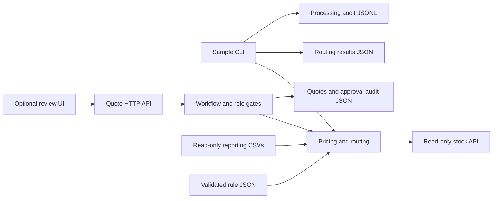
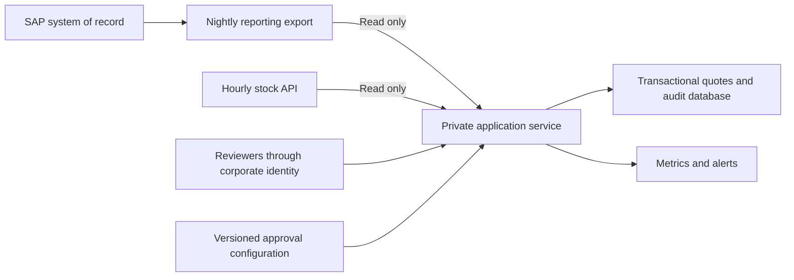

# Ridgeline Quote Approvals

## Repository

Public repository: https://github.com/tjfalcon/ridgeline-rfq. Source inputs are in `data-pack_platform/`; the challenge is in `project-description.md`.

## How to Run

Requires Node.js 24+, npm and Python 3.9+. Run these commands from this directory.

Install development tooling:

```powershell
npm ci
```

Start the supplied stock mock in one terminal:

```powershell
python .\data-pack_platform\mock_stock_api.py
```

In another terminal, generate the routing output and run checks:

```powershell
npm run process-samples
npm test
npm run typecheck
```

Start the quote API and optional lightweight UI:

```powershell
npm run dev
```

Open <http://127.0.0.1:3001>. Choose a reviewer, select a quote, inspect its lines and flags, then perform the permitted action. Stop the service with Ctrl+C.

Sample processing uses the policy clock `2026-10-12T09:30:00-05:00`. Ordinary draft imports use current time. Receipt and audit timestamps use actual time.

## Approach

The service reads reporting CSVs, applies valid contract pricing or list-price fallback, discounts the quote, checks stock over HTTP and determines the required approval route. Expired contracts use list price and produce a review flag. Money uses integer cents; the proposed discount is applied to the quote base and rounded half-up to cents. Effective discount compares net total with the total at list prices.

Approval thresholds live in `config/approval-rules.json`:

- Effective discount <=15% and net total <$25,000: specialist only.
- Discount >15% through 25%, or net total >=$25,000: regional manager.
- Discount >25%: VP, taking precedence over the amount rule.
- Out-of-office approvers fall back through the configured backup identities in the reporting export.

The key decision is separating routing from approval: identifying an approver never approves a quote. The agreed workflow is specialist review -> manager/VP approval when required -> one final specialist sign-off. Specialist-only quotes require one specialist sign-off. No customer-delivery endpoint exists.



DQ-24102 has list total $161.54; an 18% discount gives $132.46 and routes to West manager U01. DQ-24103 reaches 26.22% effective discount after contract savings and routes to VP U05. DQ-24106 routes to backup U04. DQ-24110 duplicates DQ-24102.

Duplicate identity follows the clarified requirement: same RFQ ID plus matching line numbers, regardless of part/quantity changes. The CLI compares draft timestamps within its input batch; the API compares persisted receipt timestamps within 24 hours. Identical draft-ID imports are idempotent; changed content under the same ID is rejected.

Implemented endpoints (JSON requests; `X-User-Id` required except for the UI):

| Method | Path | Purpose |
|---|---|---|
| GET | `/` | Lightweight review UI |
| POST | `/samples` | Import supplied drafts using the sample policy clock |
| POST | `/drafts` | Import `{ "drafts": [...] }` using current time |
| GET | `/quotes`, `/quotes/:id` | List or inspect quotes |
| POST | `/quotes/:id/review` | Complete initial specialist review |
| POST | `/quotes/:id/approve` | Approve at the current authorized stage |
| POST | `/quotes/:id/reject` | Reject at the current authorized stage |
| GET | `/quotes/:id/audit`, `/audit` | Quote or global audit history |

Permitted stubs: quote editing, production authentication and cross-process concurrency protection. Editing is not exposed; a future edit must invalidate approvals, reprice, refresh stock and reroute. The stock mock is supplied fixture-backed HTTP infrastructure. No extraction AI, SAP write integration or customer sending is implemented.

## Reliability

- Stock requests have three attempts, per-attempt timeout, bounded exponential backoff and bounded handling of upstream retry hints. Missing parts are not retried as transient failures. Exhaustion flags stock unavailable without guessing inventory or blocking quote preparation.
- Specialist flags cover confidence <0.85, missing/zero stock, stock older than 24 hours, reporting exports older than 36 hours, and expired contracts. The sample export is 31.5 hours old and is therefore valid.
- Missing essential pricing/customer data rejects processing rather than inventing a total. Review flags require a specialist note documenting confirmation/resolution. Currently rejecting a flagged quote also requires a note; editing/resolution is a human attestation rather than an automated correction.
- Header identities map to reporting approvers. Only specialists can perform specialist stages; only the routed approver can perform the manager/VP stage. Duplicate and terminal quotes cannot be approved.
- API quotes and audit events persist in `var/quotes.json`. Events include actor, action, time and before/after states. Failed requests are audited without raw request bodies. CLI processing has a separate `var/processing-audit.jsonl` trail. An unavailable audit store cannot reliably record its own failure; approval persistence failures do not return success.
- JSON writes are serialized within one process and replaced atomically. Failed imports roll back quote changes. Do not run multiple API processes against the same store; transactional database guarantees and tamper-proof auditing remain future work.
- Rules are validated on startup. Restart the API after changing configuration or reporting exports. Existing pending quotes are not automatically repriced or rerouted.

For a stock outage demonstration, stop the Python mock, run `npm run process-samples`, and inspect `outputs/routing_results.json` for `stock unavailable after retries`. Restart the mock and rerun to restore normal output. Existing API imports retain their stored results, so reimporting samples does not refresh stock.

For a fresh store, the API workflow can be demonstrated with:

```powershell
$base = 'http://127.0.0.1:3001'
$specialist = @{'X-User-Id'='S01'}
$manager = @{'X-User-Id'='U01'}
Invoke-RestMethod -Method Post "$base/samples" -Headers $specialist
Invoke-RestMethod -Method Post "$base/quotes/DQ-24102/review" -Headers $specialist
Invoke-RestMethod -Method Post "$base/quotes/DQ-24102/approve" -Headers $manager
Invoke-RestMethod -Method Post "$base/quotes/DQ-24102/approve" -Headers $specialist
Invoke-RestMethod "$base/quotes/DQ-24102/audit" -Headers $specialist
```

The existing demonstration store already approved DQ-24102; replaying its decisions correctly fails. Use another pending quote and its routed approver, or preserve the store and use a fresh isolated copy for a repeatable demo.

Verification: 22 automated tests cover tiers/boundaries, backups, pricing, duplicates, stale/missing/unavailable stock, retries/timeouts, malformed responses, configuration validation, HTTP roles/workflow, audit and persistence reload. `npm run typecheck` checks source and tests. Earlier live evidence includes approval surviving a process restart. The UI endpoint responds, but automated visual verification was unavailable.

## Production

Proposed deployment; these production components are not implemented:



- **Deployment:** run the service on a private network with read-only reporting/stock credentials. Store quotes and audit in its own transactional database. No SAP write permissions or route. Corporate identity replaces header identity.
- **Monitoring:** median/p95 draft-to-final-approval time, pending quote age and time by stage/region, backup usage, stock errors/retries, source freshness, denied actions and audit failures. Include pending quotes so stalled work remains visible.
- **Rules without releases:** the POC changes validated JSON and restarts without a code change. Production would use authorized, reviewed and versioned configuration outside the application image, record the applied version per quote, and explicitly handle pending quotes when policy changes.
- **Two more weeks:** transactional persistence and durable ingestion/idempotency; corporate authentication; editing with reapproval; policy/availability refresh; monitoring, recovery drills and integration tests.

Submission checklist:

- Required paths: `README.md`, `.chat-history/log.md`, `outputs/routing_results.json` and runnable tests.
- README uses the six required headings in order. Public repository: https://github.com/tjfalcon/ridgeline-rfq.
- Review the assistant log for completeness and redaction; reconstructed entries are explicitly timestamped as estimates. Full recording/log compliance is not certified.
- No application environment variables are used; an application `.env.example` is therefore not required. Exclude real `.env` files and secrets from any archive.
- Recording must be one continuous full-screen MP4 with the system clock visible, ideally <=60 minutes and never >90. Narrate stubs, demonstrate the sample routes and show the production diagram.
- Repository publication is handled separately from `ridgeline-quote-approvals.zip`, the public Drive recording link and final submission. Do not treat local tests as evidence these actions occurred.

